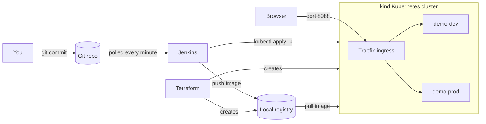

# Kubernetes DevOps Lab

A complete CI/CD project that runs on your computer at no cost. Commit code to Git, and Jenkins tests it, builds an image, deploys it to a dev environment, waits for your approval, and promotes the same image to prod. Terraform creates the Kubernetes cluster and everything the app runs on.

## Architecture



| Tool | What it does here | Where to look |
|---|---|---|
| Git | Source of truth; a new commit starts the pipeline | `main` branch |
| Terraform | Creates the cluster, registry, namespaces, ingress, metrics-server and Jenkins' permissions | `terraform/` |
| Jenkins | Runs the pipeline; its setup is stored as code | `jenkins/` |
| Kubernetes | Runs the app with rolling updates, health probes and autoscaling | `k8s/` |
| Docker | Builds and tests the app image | `app/Dockerfile` |

## Pipeline

1. **Validate manifests:** Kustomize build and a server-side dry run
2. **Unit tests:** pytest runs inside a Docker build stage
3. **Build and push:** the image is tagged with the Git commit
4. **Deploy to dev:** waits for the rollout, and rolls back if it fails
5. **Smoke test dev:** confirms the new version is being served
6. **Approve prod:** waits for you to click Deploy
7. **Deploy to prod and smoke test:** uses the same image that passed dev

## Prerequisites

- Docker Desktop, with at least 4 CPUs and 6 GB of memory (Settings > Resources)
- These command-line tools, on macOS:

```bash
brew install git kind kubectl hashicorp/tap/terraform
```

- A Git identity, if you haven't set one:

```bash
git config --global user.name "ManjulaNaga"
git config --global user.email "knmanju488@gmail.com"
```

Ports 8080 (Jenkins), 8088 (apps) and 5001 (registry) must be free.

## Quick start

```bash
make up          # Takes about 5-10 minutes the first time
make password    # Prints the Jenkins password
```

1. Open <http://localhost:8080> and sign in as `admin`.
2. Open the **demo-app** job and click **Build Now**. This first manual build is required, because polling only starts working after the job has run once.
3. When the build reaches **Approve prod**, open the paused stage and click **Deploy**.
4. Check the running apps:

```bash
curl http://app.dev.localtest.me:8088
curl http://app.prod.localtest.me:8088
```

## Try it out

**Ship a change.** Edit the message in `app/src/app.py`, and update the matching test if needed. Then commit it:

```bash
git add . && git commit -m "Change greeting"
```

Jenkins starts a new build within about a minute. Only committed changes are deployed.

**Catch a bad change.** Commit a change that fails a test, such as making `/healthz` return 500. The pipeline stops at **Unit tests** and nothing is deployed.

**Watch a rollback.** Change the `readinessProbe` path in `k8s/base/deployment.yaml` to `/nope` and commit. The new pods never become ready, so the pipeline undoes the rollout and the build fails. The old version keeps serving traffic throughout. Revert the commit when you're done.

**Check status at any time:**

```bash
make status
```

## Project layout

```text
app/                 Flask app, tests and multi-stage Dockerfile
terraform/
  cluster.tf         kind cluster and local registry
  platform.tf        Namespaces, Traefik and metrics-server
  rbac.tf            Limited Jenkins identity and its kubeconfig
k8s/
  base/              Deployment, Service, Ingress and autoscaler
  overlays/          Dev and prod differences
jenkins/
  Dockerfile         Jenkins with Docker CLI, kubectl and Kustomize
  casc.yaml          Jenkins settings and job definition
  Jenkinsfile        The pipeline
docker-compose.yml   Runs Jenkins
Makefile             Shortcut commands
```

## Using GitHub instead of the local repo

Push the project to a public GitHub repository, then add its URL to `.env`:

```bash
GIT_REPO_URL=https://github.com/<you>/<repo>.git
```

Run `make jenkins` to apply the change. A private repository also needs a Jenkins credential, which this project doesn't set up.

## Troubleshooting

| Problem | Fix |
|---|---|
| Terraform can't connect to Docker | Enable Settings > Advanced > "Allow the default Docker socket" in Docker Desktop, or run `export DOCKER_HOST=unix://$HOME/.docker/run/docker.sock` |
| A port is already in use | Stop the other program. To change the app or registry port, set `ingress_host_port` or `registry_host_port` in `terraform/terraform.tfvars`; a new registry port must also be updated in the Jenkinsfile |
| `localtest.me` doesn't resolve | Some routers block it. Use `curl -H 'Host: app.dev.localtest.me' http://127.0.0.1:8088` |
| Pods show `ImagePullBackOff` | Run `docker ps` to confirm `kind-registry` is running, then `make infra` |
| A Helm chart or provider version isn't found | Update the version in `terraform/variables.tf` or `terraform/versions.tf` |
| Jenkins is slow to start | Follow its progress with `docker logs -f jenkins` |

## Clean up

```bash
make down
```

This deletes Jenkins and its data, the cluster and the registry. Your code and Git history stay in place.

## Security notes

This project is set up for local learning. These parts need to change before any real use:

- Jenkins runs as root with access to the Docker socket, which gives it full control of Docker. Use dedicated build agents and a builder such as BuildKit or Kaniko instead.
- The registry has no login or TLS.
- metrics-server skips certificate checks on the kubelet connection.
- The Terraform state and the generated kubeconfig contain secrets and are stored on disk. Both are excluded from Git.

Some good protections are already in place: Jenkins can only deploy to the two app namespaces, containers run as non-root with a read-only filesystem, and all ports are bound to `127.0.0.1`.

## Next steps

- Move the cluster to AWS EKS, Azure AKS or Google GKE by replacing `terraform/cluster.tf`
- Scan images with Trivy as a new pipeline stage
- Add Prometheus and Grafana monitoring
- Replace the deploy stages with Argo CD for GitOps
